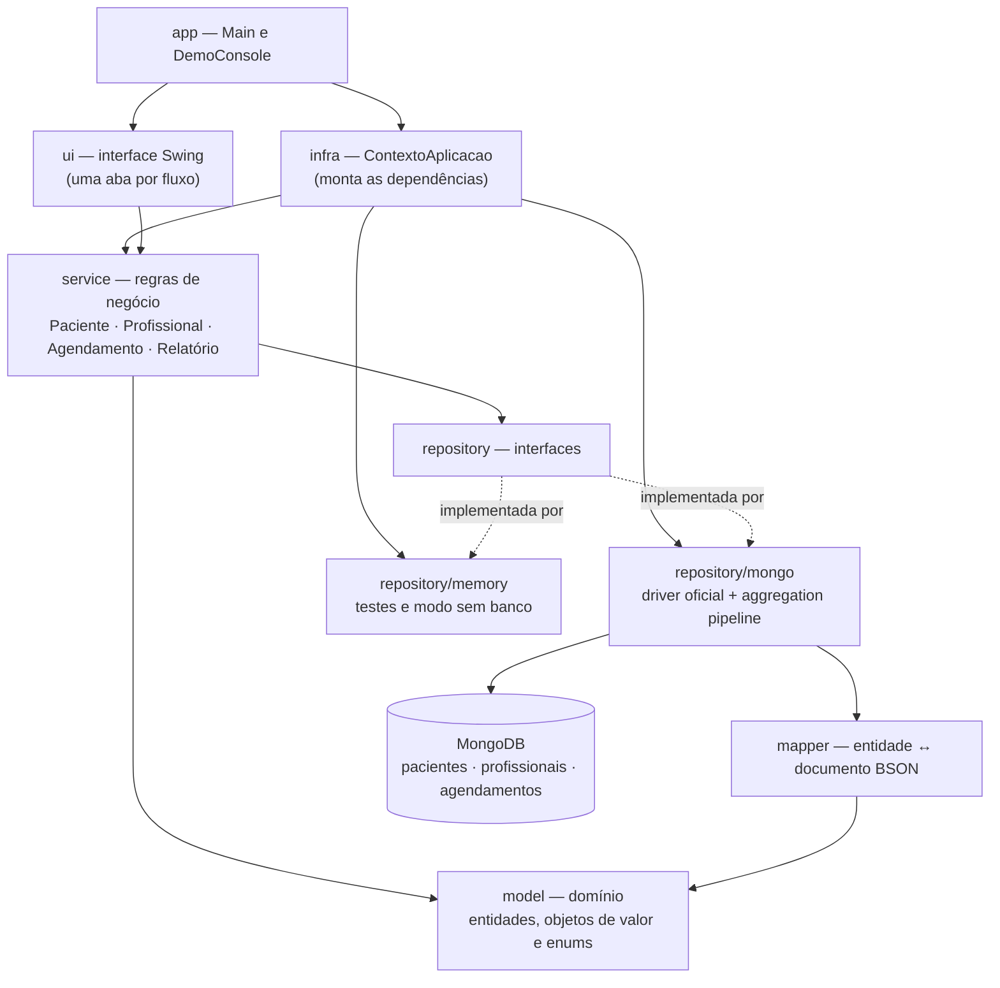
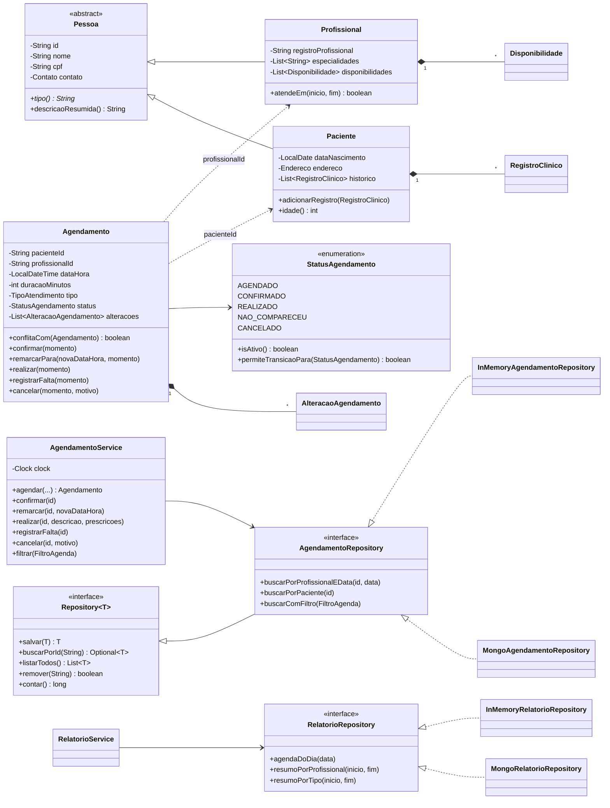
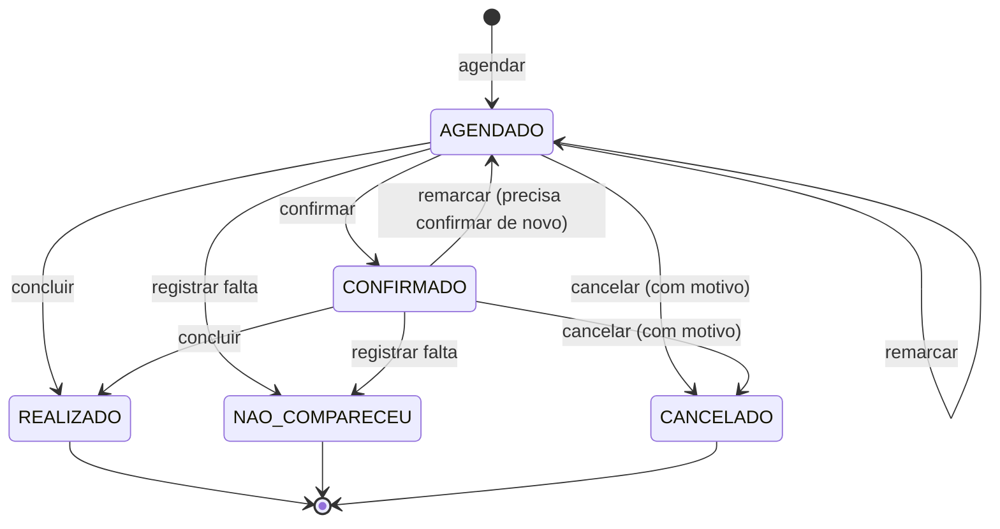

# Arquitetura

A PoC é uma aplicação Java 17 sem framework, organizada em camadas. A interface
gráfica (Swing) fala só com os **serviços**, que concentram as regras de negócio; os
serviços falam só com **interfaces de repositório**, que têm duas implementações
(MongoDB e memória). Trocar o banco não altera nenhuma regra nem nenhuma tela.

## Camadas

| Pacote | Responsabilidade |
|---|---|
| `model` | Entidades (`Paciente`, `Profissional`, `Agendamento`), objetos de valor imutáveis (`Contato`, `Endereco`, `Disponibilidade`, `RegistroClinico`, `AlteracaoAgendamento`, `FiltroAgenda`, `ItemAgendaDia`, `ResumoAtendimentos`) e enums (`TipoAtendimento`, `StatusAgendamento`). As regras que dependem só do próprio objeto ficam aqui (validação, conflito de horário, transições de status). |
| `service` | Regras que envolvem mais de um objeto ou o relógio: agendar, remarcar, registrar falta, concluir gravando o histórico, validar períodos de relatório. |
| `repository` | Contratos de persistência. `Repository<T>` traz o CRUD; cada entidade acrescenta suas consultas. `RelatorioRepository` define as consultas de leitura que cruzam coleções. |
| `repository/mongo` | Implementação com o driver oficial. `MongoRepository<T>` concentra o CRUD comum; `AgregacoesRelatorio` monta os pipelines de agregação. |
| `repository/memory` | Implementação com mapas em memória, com o mesmo comportamento. Usada pelos testes de unidade e pelo modo "sem banco". |
| `mapper` | Conversão entre entidades e documentos BSON. Mantém o domínio sem dependência do driver. |
| `infra` | `MongoConnection` (URI configurável, ping) e `ContextoAplicacao` (escolhe MongoDB ou memória e monta os serviços). |
| `ui` | Swing: `JanelaPrincipal` e uma aba por fluxo (Pacientes, Profissionais, Agendamentos, Histórico, Relatórios). `PainelFormulario` e `TabelaSimples` evitam repetição entre as abas. |
| `app` | `Main` (abre a interface, com MongoDB ou em memória) e `DemoConsole` (demonstração em modo texto). |

## Diagrama de classes (núcleo)

`PacienteRepository` e `ProfissionalRepository` seguem o mesmo desenho de
`AgendamentoRepository` (interface + implementação MongoDB + implementação em memória).

## Ciclo de vida do agendamento

AGENDADO e CONFIRMADO ocupam o horário do profissional; os outros três são finais.
Cada transição é registrada em `alteracoes`, com o momento, o status anterior, o novo
status e uma observação (motivo do cancelamento, datas da remarcação).

## Regras de negócio

| Regra | Onde fica |
|---|---|
| CPF guardado só com dígitos, com 11 dígitos e não todos iguais; CPF único por paciente | `Pessoa`, `PacienteService` e índice único no MongoDB |
| Não agendar nem remarcar para data/hora no passado | `AgendamentoService` (relógio injetável) |
| O atendimento precisa caber inteiro numa janela de disponibilidade do profissional | `Profissional.atendeEm` |
| Dois atendimentos ativos do mesmo profissional não se sobrepõem (horários encostados são permitidos) | `Agendamento.conflitaCom` |
| Transições de status só pelos caminhos do diagrama acima | `StatusAgendamento.permiteTransicaoPara` |
| Remarcação reaplica todas as regras de horário e volta o status para AGENDADO | `AgendamentoService.remarcar` |
| Falta só pode ser registrada depois do horário marcado | `AgendamentoService.registrarFalta` |
| Cancelamento exige motivo | `Agendamento.cancelar` |
| Concluir grava o atendimento no histórico clínico do paciente | `AgendamentoService.realizar` |
| Relatórios aceitam no máximo um ano de período, com fim depois do início | `RelatorioService` |

## Decisões de projeto

- **Repositórios por interface, com duas implementações.** Os serviços não sabem se os
  dados estão no MongoDB ou em memória. Isso permite testar todas as regras sem banco,
  rodar a demonstração sem infraestrutura e, nos testes de integração, comparar o
  resultado das agregações do MongoDB com a versão em memória.
- **Mapeadores separados do domínio.** Nenhuma classe de `model` importa o driver do
  MongoDB; a conversão fica nos `*Mapper`, testados com ida e volta.
- **Relógio injetável (`Clock`).** As regras de "data no passado" e "falta só depois do
  horário" são testadas de forma determinística, com um relógio fixo.
- **Agregações no banco, não na aplicação.** Agenda do dia e resumos usam `$lookup` e
  `$group`, para que o MongoDB faça o cruzamento e a contagem. Os pipelines ficam em
  `AgregacoesRelatorio`, separados do repositório, para serem testados sem banco.
- **Objetos de valor imutáveis** para o que não tem identidade própria (contato,
  endereço, janela de atendimento, registro clínico, alteração, filtro).
- **Sem framework.** Injeção de dependências feita à mão em `ContextoAplicacao`; deixa
  explícito o que cada camada recebe, que é o objetivo de uma PoC acadêmica de POO.

## Aplicação de POO

- **Herança e polimorfismo:** `Pessoa` abstrata, com `tipo()` implementado por `Paciente`
  e `Profissional`; `Profissional` sobrescreve `descricaoResumida()`.
- **Abstração:** `Repository<T>` e `RelatorioRepository`, cada um com duas implementações.
- **Classes base reutilizáveis:** `MongoRepository<T>` e `InMemoryRepository<T>` concentram
  o CRUD; as subclasses só informam o id e as consultas específicas.
- **Encapsulamento:** validação nos construtores; listas internas expostas somente leitura;
  o status do agendamento só muda pelos métodos de transição.
- **Responsabilidade única:** regra no serviço, persistência no repositório, conversão no
  mapper, apresentação na `ui`.
