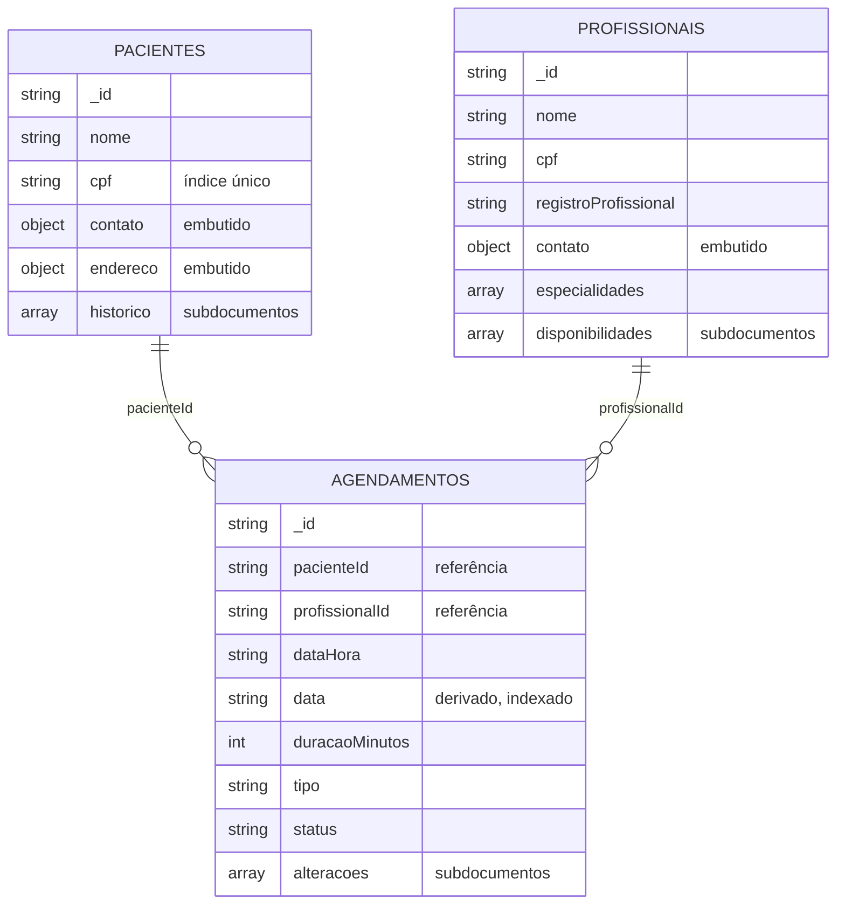

# Banco de dados (MongoDB)

A PoC usa **três coleções** no banco `poc_saude` (configurável): `pacientes`,
`profissionais` e `agendamentos`. Atende aos requisitos do semestre: **múltiplas
coleções**, **relacionamento entre coleções** (por referência de id) e **objetos
complexos** (documentos aninhados e listas de subdocumentos nas três coleções).

## Relacionamentos



## Embutir ou referenciar

| Dado | Escolha | Por quê |
|---|---|---|
| `contato`, `endereco` | Embutido no paciente/profissional | Pertencem a uma pessoa só e são sempre lidos junto com ela. |
| `historico` (registros clínicos) | Lista embutida no paciente | O histórico é consultado sempre a partir do paciente, e cresce de forma limitada numa clínica pequena. Ler o paciente já traz o histórico, sem segunda consulta. |
| `disponibilidades`, `especialidades` | Listas embutidas no profissional | São usadas em toda checagem de agendamento e não existem fora do profissional. |
| `alteracoes` do agendamento | Lista embutida no agendamento | É a trilha de auditoria daquele agendamento; só faz sentido junto com ele. |
| Paciente e profissional no agendamento | **Referência** (`pacienteId`, `profissionalId`) | Um paciente tem muitos agendamentos e um profissional também. Embutir duplicaria os cadastros e deixaria cópias desatualizadas quando um nome ou contato mudasse. Os nomes são trazidos quando necessário com `$lookup`. |

## Coleção `pacientes`

```json
{
  "_id": "9f2c...-uuid",
  "nome": "Maria Souza",
  "cpf": "52998224725",
  "dataNascimento": "1990-04-12",
  "contato": { "email": "maria@email.com", "telefone": "44 90000-0000" },
  "endereco": { "rua": "Rua A, 100", "cidade": "Maringá", "estado": "PR" },
  "historico": [
    {
      "data": "2026-03-09",
      "tipo": "CONSULTA",
      "profissionalId": "5a1b...-uuid",
      "descricao": "Consulta de rotina em cardiologia",
      "prescricoes": ["Losartana 50mg - 1x ao dia"]
    }
  ]
}
```

## Coleção `profissionais`

```json
{
  "_id": "5a1b...-uuid",
  "nome": "Dr. Carlos Lima",
  "cpf": "11144477735",
  "registroProfissional": "CRM-PR 12345",
  "contato": { "email": "carlos@clinica.com", "telefone": "44 91111-1111" },
  "especialidades": ["Cardiologia"],
  "disponibilidades": [
    { "diaSemana": "MONDAY", "horaInicio": "08:00", "horaFim": "12:00" },
    { "diaSemana": "WEDNESDAY", "horaInicio": "14:00", "horaFim": "18:00" }
  ]
}
```

## Coleção `agendamentos`

```json
{
  "_id": "c7d4...-uuid",
  "pacienteId": "9f2c...-uuid",
  "profissionalId": "5a1b...-uuid",
  "dataHora": "2026-03-16T10:00",
  "data": "2026-03-16",
  "duracaoMinutos": 30,
  "tipo": "CONSULTA",
  "status": "CANCELADO",
  "alteracoes": [
    { "momento": "2026-03-02T09:12:40", "statusAnterior": "AGENDADO", "statusNovo": "CONFIRMADO" },
    { "momento": "2026-03-05T14:03:11", "statusAnterior": "CONFIRMADO", "statusNovo": "AGENDADO",
      "observacao": "Remarcado de 09/03/2026 09:00 para 16/03/2026 10:00" },
    { "momento": "2026-03-10T08:30:02", "statusAnterior": "AGENDADO", "statusNovo": "CANCELADO",
      "observacao": "Motivo: Paciente viajou" }
  ]
}
```

- `status` pode ser `AGENDADO`, `CONFIRMADO`, `REALIZADO`, `NAO_COMPARECEU` ou `CANCELADO`
  (ciclo de vida em [arquitetura.md](arquitetura.md#ciclo-de-vida-do-agendamento)).
- `data` é **derivado** de `dataHora` e guarda só o dia (`yyyy-MM-dd`). Com ele, "agenda do
  profissional no dia" vira uma igualdade indexável, e filtros por período viram comparação
  de texto, que respeita a ordem cronológica nesse formato.
- Documentos gravados antes da lista `alteracoes` existir continuam sendo lidos (com
  histórico vazio).

## Índices

| Coleção | Índice | Usado por |
|---|---|---|
| `pacientes` | `{ cpf: 1 }` **único** | Garante no banco a regra de CPF único (erro 11000 em duplicata). |
| `agendamentos` | `{ profissionalId: 1, data: 1 }` | Agenda do profissional no dia (checagem de conflito) e filtros por profissional. |
| `agendamentos` | `{ pacienteId: 1 }` | Agenda do paciente. |
| `agendamentos` | `{ data: 1, status: 1 }` | Filtros por período e status sem profissional, e o `$match` dos relatórios. |

Os índices são criados pelos repositórios ao iniciar (`createIndex` é idempotente).

## Agregações (relatórios)

### Agenda do dia — `$lookup`

```json
[
  { "$match": { "data": "2026-03-09" } },
  { "$lookup": { "from": "pacientes", "localField": "pacienteId", "foreignField": "_id", "as": "paciente" } },
  { "$unwind": { "path": "$paciente", "preserveNullAndEmptyArrays": true } },
  { "$lookup": { "from": "profissionais", "localField": "profissionalId", "foreignField": "_id", "as": "profissional" } },
  { "$unwind": { "path": "$profissional", "preserveNullAndEmptyArrays": true } },
  { "$sort": { "dataHora": 1 } },
  { "$project": { "_id": 0, "dataHora": 1, "tipo": 1, "status": 1,
                  "pacienteNome": "$paciente.nome", "profissionalNome": "$profissional.nome" } }
]
```

`preserveNullAndEmptyArrays` mantém o agendamento na agenda mesmo se o paciente ou o
profissional tiver sido removido; a aplicação mostra "(removido)".

### Resumo por profissional — `$group`

```json
[
  { "$match": { "data": { "$gte": "2026-03-01", "$lte": "2026-03-31" } } },
  { "$group": {
      "_id": "$profissionalId",
      "total": { "$sum": 1 },
      "realizados": { "$sum": { "$cond": [{ "$eq": ["$status", "REALIZADO"] }, 1, 0] } },
      "faltas":     { "$sum": { "$cond": [{ "$eq": ["$status", "NAO_COMPARECEU"] }, 1, 0] } },
      "cancelados": { "$sum": { "$cond": [{ "$eq": ["$status", "CANCELADO"] }, 1, 0] } } } },
  { "$lookup": { "from": "profissionais", "localField": "_id", "foreignField": "_id", "as": "profissional" } },
  { "$unwind": { "path": "$profissional", "preserveNullAndEmptyArrays": true } },
  { "$project": { "_id": 0, "grupo": { "$ifNull": ["$profissional.nome", "(removido)"] },
                  "total": 1, "realizados": 1, "faltas": 1, "cancelados": 1 } },
  { "$sort": { "total": -1, "grupo": 1 } }
]
```

O resumo por tipo de atendimento é o mesmo `$match` + `$group`, agrupando por `$tipo`.
A partir dos totais a aplicação calcula pendentes e **% de faltas** (faltas sobre
atendimentos já ocorridos), indicador de absenteísmo ligado ao ODS 3.

## Configuração da conexão

| Variável de ambiente | Propriedade de sistema | Padrão |
|---|---|---|
| `MONGODB_URI` | `-Dmongodb.uri` | `mongodb://localhost:27017` |
| `MONGODB_DATABASE` | `-Dmongodb.database` | `poc_saude` |
| `MONGODB_URI_TESTES` (só testes) | `-Dmongodb.uri.testes` | `mongodb://localhost:27017` |

Funciona também com MongoDB Atlas (`mongodb+srv://...`); a interface mostra a URI sem
usuário e senha.
