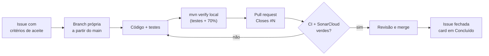

# Processo de desenvolvimento

A segunda entrega foi desenvolvida com **Kanban**, usando o GitHub Projects como quadro
de tarefas e um fluxo de **issue → branch → pull request → revisão → merge**.

- **Quadro de tarefas:** [AEP 2026.2 — PoC Saúde](https://github.com/users/YagoGarcia06/projects/2)
- **Issues da 2ª entrega:** [milestone "2ª entrega"](https://github.com/YagoGarcia06/AEP-Esoft6S/milestone/1)

## Quadro Kanban

| Coluna | Significado |
|---|---|
| Backlog | Tarefa definida, com critérios de aceite, ainda não iniciada. |
| Ready | Pronta para ser puxada. |
| Em andamento | Alguém está trabalhando nela, em uma branch própria. |
| Revisão | Pull request aberto, aguardando checagens e revisão. |
| Concluído | Pull request mesclado; a issue é fechada automaticamente. |

As automações do quadro movem os cards: uma issue fechada ou um pull request mesclado vai
para **Concluído** sem intervenção manual.

## Fluxo de trabalho

1. Cada funcionalidade começa como **issue**, com descrição e critérios de aceite em
   checklist, label e milestone.
2. O trabalho é feito numa **branch** criada a partir do `main` atualizado.
3. Cada commit traz código **e** testes; antes do push roda-se `./mvnw clean verify`.
4. O **pull request** referencia a issue com `Closes #N` e descreve o que mudou e como foi
   testado.
5. O PR só é mesclado com o **CI** (GitHub Actions) e o **SonarCloud** (Quality Gate) verdes.
6. O merge fecha a issue e move o card no quadro. Os PRs são mesclados na ordem das issues,
   e cada nova branch nasce do `main` já atualizado.

## Convenções

| Item | Convenção | Exemplos |
|---|---|---|
| Branch | `tipo/descricao-curta` | `feat/relatorios-agregacao`, `test/integracao-mongo`, `ci/github-actions`, `docs/documentacao-tecnica` |
| Commit | Tipo no início da mensagem (`feat`, `test`, `ci`, `docs`, `chore`), resumo no imperativo e `refs #N` | `feat: adiciona filtros de agenda por periodo, profissional e status` |
| Pull request | Título com a issue, `Closes #N` na descrição, seções "O que muda" e "Testes" | `Filtros de agenda (#4)` |
| Labels | `funcionalidade`, `testes`, `infra`, `documentacao`, `entrega` | — |

## Qualidade automatizada

| Ferramenta | Quando roda | O que garante |
|---|---|---|
| JUnit 5 + JaCoCo (`mvn verify`) | Localmente e no CI | Testes passando e cobertura mínima de 70% de linhas e de branches; o build falha abaixo disso. |
| GitHub Actions ([`ci.yml`](../.github/workflows/ci.yml)) | Todo push e todo PR | Mesmo `verify`, com um MongoDB 7 real para os testes de integração; publica o relatório do JaCoCo. |
| SonarCloud | Todo push e todo PR | Análise estática (bugs, vulnerabilidades, code smells, duplicação) com Quality Gate. |

## Histórico da 2ª entrega

| Issue | Pull request | Entrega |
|---|---|---|
| #1 Ciclo de vida do agendamento | #9 | Confirmar, remarcar, registrar falta; novos status |
| #2 Histórico de alterações do agendamento | #10 | Trilha de alterações como subdocumentos; motivo obrigatório no cancelamento |
| #3 Relatórios com agregação no MongoDB | #11 | Agenda do dia (`$lookup`) e resumos (`$group`); aba Relatórios |
| #4 Filtros de agenda | #12 | Filtro por período, profissional e status; índice `(data, status)` |
| #5 Testes de integração com MongoDB | #13 | Testes contra MongoDB real, ignorados quando não há banco |
| #6 CI com GitHub Actions | #14 | Pipeline com MongoDB, cobertura e artefatos |
| #7 Documentação técnica | este PR | `docs/`, CHANGELOG e README atualizado |
| #8 Release da 2ª entrega e vídeo | — | Release `v2.0-entrega2` e vídeo de demonstração |
